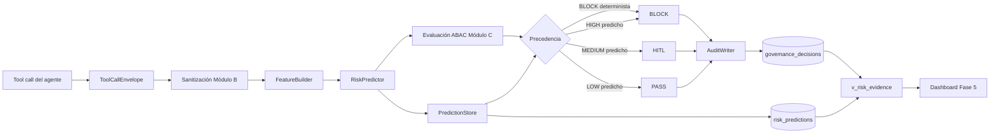
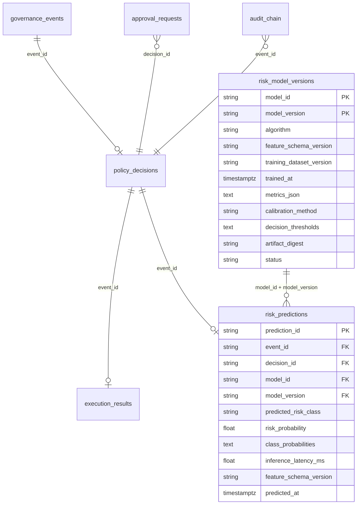

# Arquitectura y evidencia de la capa predictiva

> **Proyecto de tesis.** Documentación en español.
> Este documento cierra la Fase 5 del [plan de continuación](../plan-continuacion.md):
> describe la arquitectura de la capa predictiva, el modelo de datos con sus
> relaciones y cardinalidades, la trazabilidad completa
> corpus → modelo → predicción → decisión → visualización, y la separación
> entre resultados de ingeniería y resultados analíticos.

---

## 1. Arquitectura de la capa predictiva

La capa predictiva se inserta **dentro** del PEP (Policy Enforcement Point),
entre la sanitización y la evaluación determinista. Nunca ejecuta la
herramienta: solo informa la decisión.



### 1.1 Componentes

| Componente | Archivo | Responsabilidad |
|---|---|---|
| **Feature Builder** | `src/argentgob/analytics/features.py` | Deriva el vector canónico de 27 features pre-ejecución desde `telemetry_arguments` (nunca desde el payload crudo). Bloques: `context.*`, `payload.*`, `control.*`. |
| **Risk Model** | `data/models/risk_model_v1/pipeline.joblib` | Pipeline `ColumnTransformer → LogisticRegression` calibrado con isotonic. Entrenado en Fase 3 sobre `corpus_v1`. |
| **Model Registry** | `risk_model_versions` (migración 005) | Versiones del modelo: algoritmo, esquema de features, dataset de entrenamiento, métricas, umbrales y digest del artefacto. |
| **Inference Service** | `src/argentgob/analytics/predictor.py` | Carga artefactos, normaliza `predict_proba` a LOW/MEDIUM/HIGH, aplica el umbral HIGH y degrada a `None` si no está disponible (fallback fail-closed). |
| **Prediction Store** | `src/argentgob/analytics/store.py` | Persiste la predicción en `risk_predictions` (fail-open de observabilidad) y vincula el `decision_id` final. |
| **Evidence Service** | `src/argentgob/analytics/evidence.py` | `PredictionQueryService` (consultas sobre `v_risk_evidence`) y `ModelEvidenceService` (recálculo reproducible de métricas sobre la partición congelada). |
| **Evidence UI** | `src/argentgob/dashboard/evidence.py` | Sección «Fase 5 · Evidencia predictiva» del dashboard Streamlit. |

### 1.2 Precedencia de decisión

1. **BLOCK determinista** (política o guardrail) gana siempre.
2. **HIGH predicho** → BLOCK (`PREDICTED_HIGH_RISK`).
3. **MEDIUM predicho sobre PASS** → HITL (`PREDICTED_MEDIUM_RISK`, protocolo H6 durable).
4. **LOW predicho** → mantiene la decisión determinista.
5. **Modelo ausente o error de inferencia** → fallback determinista fail-closed.

---

## 2. Modelo de datos

### 2.1 Tablas y relaciones



### 2.2 Cardinalidades

| Relación | Cardinalidad | Notas |
|---|---|---|
| `governance_events` → `policy_decisions` | 1 : 0..1 | Una decisión por evento (`event_id` único). |
| `policy_decisions` → `execution_results` | 1 : 0..1 | Un resultado por evento. |
| `policy_decisions` → `risk_predictions` | 1 : 0..1 | Una predicción por evento (`prediction_id = pred-<event_id>`). |
| `risk_model_versions` → `risk_predictions` | 1 : 0..N | Una versión puede explicar muchas predicciones. |
| `policy_decisions` → `approval_requests` | 1 : 0..N | Solo cuando la decisión es HITL. |

### 2.3 Vista de evidencia

`v_risk_evidence` (migración 006) cruza `risk_predictions` con
`governance_decisions` por `event_id` y expone 17 columnas sanitizadas:
identificadores, versión del modelo, clase y probabilidades, latencia de
inferencia, decisión final (`final_action`, `final_reason_code`) y contexto de
la tool call. **No expone** `execution_arguments` ni payload crudo (INV-05).

Grants: `argentgob_app` lee y escribe las tablas base; los roles de consola
(`argentgob_console_viewer`, `_auditor`, `_operator`) solo leen la vista,
`risk_predictions` y `risk_model_versions`.

---

## 3. Trazabilidad corpus → modelo → predicción → decisión

| Eslabón | Artefacto | Identificador |
|---|---|---|
| **Corpus** | `data/corpus/corpus_v1.parquet` + `corpus_manifest.json` | `corpus_version = corpus_v1`, `feature_schema_version = v1`, `evaluation_freeze_hash` |
| **Modelo** | `data/models/risk_model_v1/` | `model_id = risk_model_v1`, `model_version = v1`, `artifact_digest = sha256:6443f7…` |
| **Registro** | `risk_model_versions` | PK `(model_id, model_version)` |
| **Predicción** | `risk_predictions` | `prediction_id = pred-<event_id>`, `feature_schema_version` |
| **Decisión** | `governance_decisions` | `decision_id`, `reason_code` (`PREDICTED_HIGH_RISK` / `PREDICTED_MEDIUM_RISK`) |
| **Visualización** | `v_risk_evidence` → dashboard | Cruce por `event_id` |

La cadena es verificable en cualquier momento:

```sql
SELECT p.prediction_id, p.model_version, p.predicted_risk_class,
       p.risk_probability, d.action, d.reason_code
FROM risk_predictions p
LEFT JOIN governance_decisions d ON d.event_id = p.event_id
ORDER BY p.predicted_at DESC;
```

---

## 4. Resultados: separación por naturaleza

La tesis distingue tres tipos de resultados que **no deben mezclarse**.

### 4.1 Tests de software (ingeniería)

Verifican que el prototipo hace lo que declara: invariantes, precedencias,
persistencia, degradación segura.

| Suite | Alcance | Resultado |
|---|---|---|
| `pytest tests/` | Unitarios + integración | **253 passed** |
| `tests/unit/test_analytics_integration.py` | FeatureBuilder, RiskPredictor, precedencias, fallback, persistencia | 11 passed |
| `tests/unit/test_evidence.py` | Divergencias, consultas parametrizadas, métricas reproducibles, INV-05 | 21 passed |
| `scripts/e2e_h8_console.py` | Consola sanitizada y resolución autorizada | 23/23 |
| `scripts/e2e_fase4_predictive.py` | Inferencia en el PEP contra PostgreSQL | 6/6 |
| `scripts/e2e_fase5_evidence.py` | Trazabilidad completa y evidencia | 19/19 |

### 4.2 Métricas analíticas de detectores (deterministas)

Corresponden a los detectores de los Módulos B y C, **no** al modelo
predictivo. Son deterministas y no tienen matriz de confusión:

- Sanitización PII: 4 regex fijos (SECRET, EMAIL, PAYMENT_NUMBER, POSSIBLE_DNI).
- Detección de inyección SQL/shell: patrones fijos en `module_c/guardrails.py`.
- Guardrails de dominio: query injection, topic relevance, rate limit.

### 4.3 Métricas predictivas del modelo (partición de evaluación congelada)

Recalculadas por `ModelEvidenceService` sobre las 600 filas de `evaluation`
(nunca usadas en entrenamiento ni calibración):

| Métrica | Valor |
|---|---|
| Macro F1 | 0.9985 |
| Balanced accuracy | 0.9989 |
| Recall HIGH | 1.0000 |
| Precision HIGH | 1.0000 |
| Falsos negativos de HIGH | 0 |
| Log loss | 0.0341 |
| Brier (HIGH) | 0.0096 |
| Latencia P50 / P95 / P99 | 11.62 / 12.08 / 12.09 ms |

**Matriz de confusión** (filas = real, columnas = predicho):

| real \ pred | LOW | MEDIUM | HIGH |
|---|---|---|---|
| **LOW** | 299 | 1 | 0 |
| **MEDIUM** | 0 | 180 | 0 |
| **HIGH** | 0 | 0 | 120 |

**Curva de calibración**: la probabilidad de HIGH está calibrada con isotonic;
en cada bin `mean_predicted ≈ observed_frequency` (verificable en el dashboard).

> **Advertencia metodológica:** el corpus es sintético y generado por reglas.
> Las métricas casi perfectas reflejan que el modelo aprende la rúbrica de
> etiquetado, no el comportamiento de un corpus real. La validez externa queda
> como trabajo futuro (ver §5).

---

## 5. Límites y trabajo futuro

- **Validez externa:** el corpus es sintético; se requiere un corpus real
  etiquetado para afirmar generalización.
- **Monitoreo de deriva:** no implementado; la tabla `risk_model_versions`
  deja el lugar para registrar nuevas versiones y comparar métricas.
- **Detector PII probabilístico:** fuera de alcance; los regex siguen siendo
  la barrera dura.
- **HITL con modelo activo:** el protocolo H6 está implementado y probado,
  pero la tasa de HITL originada por predicción depende de la distribución de
  tráfico real.
