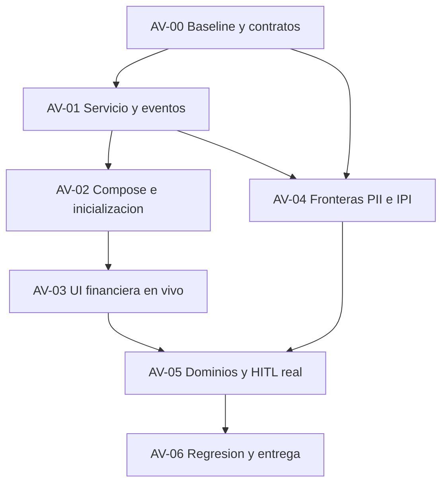

# Hitos operativos y gates — v3

Estado inicial: **todos pendientes**. Los nombres técnicos son objetivos, no prueba de existencia. [Contratos](contratos.md), [catálogo](escenarios.md), [despliegue](despliegue.md) y [pruebas](verificacion.md) son lectura aplicable obligatoria.

## 1. Dependencias y orden

AV-04 requiere el contrato/callback de AV-01, no necesita esperar a toda la UI. Orden secuencial recomendado: AV-00 → 01 → 02 → 03 → 04 → 05 → 06. Si se trabaja en paralelo, preservar las dependencias reales indicadas; no lanzar AV-05 con fronteras de contenido pendientes. Cada unidad es cohesionada y se valida antes de ampliar alcance.

## 2. AV-00 — Baseline operativo y contratos cerrados

**Entrada:** [índice](README.md), plan normativo externo y evidencia histórica disponibles; rama `agents/…`; sin asumir estado de contenedores por documentación antigua.

**Unidades:**

1. Registrar commit/worktree, versiones instaladas, migraciones presentes/aplicadas, estado del stack y artefactos del modelo. No imprimir secretos.
2. Ejecutar baseline real en Podman y distinguir tests sin red, PG real, tools CrewAI y LLM local. Los 334/9 son referencia histórica, no oráculo numérico.
3. Mapear contratos a rutas reales: builder, PEP, transformador activo, callback, identidad H8, hold/resume y persistencia de liberación de contenido.
4. Confirmar cómo se transmite prueba de actor y token al proceso propietario del hold. Verificar revalidación efectiva de política/digest/guardrails; docstring no es evidencia.
5. Fijar las decisiones que requieran ajuste mínimo: persistencia de control de contenido, correlación durable, secreto canónico y compatibilidad Compose. Si hace falta DDL, documentar alcance/migración y tests antes de AV-04/05.
6. Fijar schemas, recursos, catálogo de perfiles, límites y oráculos de este paquete; actualizar solo discrepancias comprobadas, sin crear otro framework de configuración.

**Pruebas:** T-R01, T-R02 baseline, T-R04; smoke llama.cpp real para identificar versión/modelo; inspección/ejecución mínima de roles/DB según preflight. No ejecutar pruebas de nuevas rutas inexistentes.

**Gate G-AV-00:** baseline reproducible con resultados/limitaciones registrados; mapa de rutas y decisiones de contrato sin bloqueos para AV-01; oráculos y prerequisitos de AV-02/04/05 definidos. Si no hay DB/LLM para los chequeos exigidos, estado BLOCKED, no inferir disponibilidad.

**Entregables:** resumen de baseline en sesión, decisiones breves dentro de los documentos aplicables, tabla de tests existentes/reutilizables y comandos exactos disponibles. Esta documentación inicial no reemplaza esos resultados.

## 3. AV-01 — Servicio HTTP, supervisor y eventos

**Entrada:** G-AV-00 PASS y contratos API/eventos/actor acordados.

**Unidades:**

1. API interna tipada, validación de payload/perfil/actor y reserva/idempotencia atómicas. Dependencias directas FastAPI/ASGI solo al implementarlas.
2. Supervisor de un proceso por run; estado aislado, timeouts y terminación confirmada. Mantener CLI financiera y configuración llama.cpp probada.
3. Callback explícito, canal IPC cerrado y eventos por tentativa; buffer/TTL/cursor acotados. Observer no duplica decisiones ni efectos.
4. Proyectar informe/errores financieros y estados parciales; no publicar verbose/stdout.
5. Crear gate agregado ligero reutilizando pytest/runners; validar selección no vacía y evidencia sanitizada.

**Tests objetivo:** unitarios API/supervisor/events; integración por tool pública; tests existentes PEP/rate limit/logger. Casos T-B01…T-B08, T-B09 para backend, T-P05 financiero y T-R03. Un smoke con CrewAI + llama.cpp real y PG acredita ≥1 tentativa real, aunque una decisión sea HITL/BLOCK.

**Gate G-AV-01:** validación negativa sin inferencia/tool, carreras sin duplicados, proceso terminado antes de liberar cupo, evento consultable antes del final y salida segura. Smoke real sin monkeypatch del LLM y regresión financiera/CLI pasan. No exige UI aún.

**Entregables:** servidor/supervisor, contrato de eventos implementado, tests y gate ejecutable, evidencia del smoke; documentación de configuración implementada. No afirmar todavía resume interactivo completo.

## 4. AV-02 — Compose e inicialización reproducibles

**Entrada:** G-AV-01 PASS, API empaquetable y permisos/seed definidos.

**Unidades:**

1. Convertir agent a API persistente sin stdin/tty. Declarar healthchecks y readiness coherentes; dashboard independiente de LLM.
2. Inicializador Alembic + seed validado con fallo propagado; no profile opcional para dependencia obligatoria. Revisar pruning y versiones de políticas.
3. Secretos/variables por consumidor; red/puertos mínimos; rutas GGUF/predictor/fixtures parametrizadas y RO; pin probado de llama.cpp.
4. Compatibilidad proveedor Compose real; preflight y comprobaciones de esquema sin sleeps ciegos.
5. Arranque aislado desde DB vacía, upgrade y segundo arranque; smoke de imagen sin montar fuentes. Rollback/restore de DB de prueba si se cambia DDL.

**Tests objetivo:** T-A01…T-A08; regresión T-B04/T-B08; PG real para catálogo/roles y humo LLM de imagen. Pruebas de imagen y topología no se sustituyen con parseo YAML.

**Gate G-AV-02:** inicializador exit 0 y postcondiciones verificadas, stack saludable con precondiciones cumplidas, arranque repetible sin pérdida de datos; sin LLM la UI/auditoría siguen y no se aceptan runs LLM. Puertos/roles/secreto y artefactos reales funcionan. Fallo de migrator/seed impide admisión.

**Entregables:** compose/entrypoint mínimo si hace falta, config validada, pruebas de arranque, documentación de operación/preflight/rollback y evidencia segura de imagen.

## 5. AV-03 — UI financiera en vivo

**Entrada:** G-AV-02 PASS y API/eventos disponibles por red interna.

**Unidades:**

1. Nueva sección en Operaciones y Demo sin sustituir demo actual. Actor/perfil permitido y campo financiero acotado.
2. Session state conserva intención/run/cursor; POST solo por intención explícita. Polling de región activa, no refresco global bloqueante.
3. Timeline distingue tool, decisión, ejecución, contenido, parcialidad y HITL pendiente; informe saneado y link de evidencia.
4. Manejo de API caída, recarga, dos sesiones, expiración/truncado; no exponer admin ni consola raw.

**Tests objetivo:** T-B02/T-B03/T-B05/T-B06/T-B07/T-B09, T-P05 y T-R02; AppTest + navegador con LLM real. No basta screenshot del resultado final.

**Gate G-AV-03:** una operación visible antes del fin, visibilidad ≤3 s medida bajo el escenario acordado, rerun/doble clic sin repetir POST, polling detenido en terminal, datos/errores sin fuga y demo anterior funcionando. HITL se muestra como pendiente, no aprobado automáticamente.

**Entregables:** UI/cliente API, tests AppTest, recorrido browser con timestamps/IDs seguros y evidencia financiera real.

## 6. AV-04 — Fronteras PII e IPI

**Entrada:** G-AV-00 y G-AV-01 PASS; resolución sobre persistencia/correlación de contenido. No depende de tener los cinco dominios completos.

**Unidades:**

1. Schemas públicos, fixture canario sintética, detector sin valor y proyección por campo para entrada/salida; considerar números, claves y anidados.
2. Transformación explícita cuando sea operativamente necesaria, sin mutación ni sustitución con telemetría; mantener semántica de las claves de búsqueda.
3. Control de liberación IPI sobre texto antes del LLM; distinguir lectura permitida y contenido retenido. Persistir evidencia sin raw.
4. Validar catálogo de guardrails al inicio y fallo cerrado por desconocido/error.
5. Verificar impacto sobre features/corpus/predictor financiero. Migración solo si el contrato durable acordado la necesita; incluir upgrade/roles y compatibilidad.

**Tests objetivo:** T-P01…T-P06, T-I01…T-I05, T-D01, T-R03/T-R04. Integración espía sobre mensajes del cliente LLM prueba no-leak; no persistir los mensajes inspeccionados. Smoke con LLM real y documento limpio/retención antes de conectar todos los casos.

**Gate G-AV-04:** canarios ausentes de primer prompt/resultados publicados/logs/DB, argumentos operativos correctos, original intacto, documento retenido no entra al LLM y evidencia durable distingue controles. Corpus congelado preservado o cambio versionado y justificado. Límites de detector/falsos positivos explícitos.

**Entregables:** fronteras/transformación mínimas, schemas/fixtures, tests no-leak y control de resultado; migración y prueba si corresponde; documentación de cobertura/limitaciones.

## 7. AV-05 — Cinco dominios, HITL y demos LLM reales

**Entrada:** G-AV-03 y G-AV-04 PASS, stack/evidencia de DB real y fronteras disponibles.

**Unidades en orden:**

1. Catálogo/builder público reutilizable, prompts y perfil/políticas exactas. Implementar trámites y demostrar lectura minimizada.
2. Comunicaciones con lectura y liberación controladas; borrador sin enviar. Normativa con corpus pequeño/citas/abstención. Auditoría con referencias y verificador real.
3. Beneficios: lectura y propuesta no vinculante; WRITE simulado con HITL explícito, hold en propietario, identidad H8 y token seguro.
4. Completar revalidación/guardrails antes del resume y capability de un uso. No replay del Crew ni continuación de razonamiento implícita.
5. Integrar selector de casos en UI y runner de D-01…D-12 con inferencia llama.cpp real y proveedores explícitos.
6. Separar demo humana de pruebas automatizadas: D-03 interactiva espera operador; integración aislada puede usar identidad fixture y resolver de test, nunca habilitado en modo real.

**Tests objetivo:** T-B03/T-B04/T-B09, T-P01…T-P06, T-I01…T-I05, T-H01…T-H07, T-D01…T-D03, T-J01…T-J04 y T-R05. YAML/perfiles/prompts y expansión de tool/clase coherentes. PG real obligatorio para autorización/carreras/consumo y evidencia de contenido.

**Gate G-AV-05:** cinco flujos con tarea/prompt y herramientas propias; D-01…D-12 con inferencia real y oráculos satisfechos; cero efectos antes de aprobación, máximo una ejecución tras resume, rechazo/vencimiento/hold perdido seguros. Documentos retenidos nunca ingresan al contexto. Predictor público rotulado no validado y organismos simulados visibles. No cerrar porque un test unitario simule estos resultados.

**Entregables:** tools mínimas, perfiles/prompts/YAML, fixtures versionadas, UI ampliada, runner y tests; evidencia por D y recorridos humanos HITL, límites documentados.

## 8. AV-06 — Regresión, evidencia y entrega operable

**Entrada:** G-AV-00…G-AV-05 PASS sobre versiones compatibles; árbol final identificado. Cambios posteriores invalidan gates afectados.

**Unidades:**

1. Rebuild/redeploy final de imágenes afectadas desde checkout con GGUF; smoke sin bind mount.
2. Suite completa, integración PG real, corpus, E2E existentes y nuevo runner LLM; comprobar tests requeridos no skipped.
3. Repetir arranque limpio/repetido y fallos aislados sobre configuración final; no tocar DB/servicios compartidos para fabricar evidencia.
4. Revisar no-leak de reportes, coherencia UI/API/auditoría, restricciones de permisos y límites de recuperación.
5. Actualizar consideraciones, índice de este paquete, README operativo y resumen de sesión. Reconciliar documentación académica afectada sin cambiar resultados históricos como si se hubieran repetido.

**Tests objetivo:** T-R01…T-R06 más gates A/B/P/I/H/D/J dependientes del diff final; D-01…D-12; E2E H8 23 checks, Fase4 6 y Fase5 19 según scripts actuales, además de demo anterior 5 escenarios. Conteos históricos son referencia: registrar resultados reales y nuevas pruebas sin objetivos numéricos artificiales.

**Gate G-AV-06:** todos los requisitos de [trazabilidad](README.md) con evidencia actual, sin fallos ni skips obligatorios; instalación, operación degradada, imagen, privacidad y HITL demostrados. Si faltan GPU/DB/autorización humana, resultado BLOCKED con pendientes explícitos, no cierre parcial como total.

**Entregables:** paquete implementado y reproducible, reporte agregado sanitizado, guía de arranque/demo/operación y límites, resumen de sesión y documentación rectora actualizada. Publicación/merge solo tras validación y conforme al ciclo del proyecto.

## 9. Regla común de cierre y alcance de esta sesión

Cada gate registra comandos, exit codes, árbol/imagen/configuración, tests descubiertos y ejecutados, resultados, limitaciones e IDs seguros según [verificación](verificacion.md). Una unidad puede quedar validada aunque otro hito siga bloqueado, pero no elimina dependencias del DAG. No declarar un AV completo por tener sus tablas o documentos.

**Esta sesión entrega el plan y actualiza instrucciones.** No implementa AV-01…06 ni ejecuta G-AV-00. Para documentación sola se validan enlaces, coherencia y diff; no rebuild, LLM, migración ni redeploy innecesarios.
